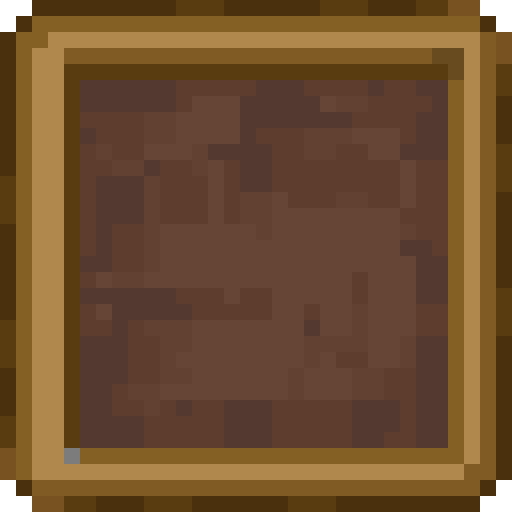

<!-- PROJECT BADGES -->
<div align="center">

[![Packagist][packagist-badge]][packagist-url]
[![CI][ci-badge]][ci-url]
[![Stars][stars-badge]][stars-url]
[![License][license-badge]][license-url]

</div>


<!-- PROJECT LOGO -->
<br />
<div align="center">
  
  <h3>libasynform</h3>
  <p align="center">
    Form classes for <a href="https://github.com/SOF3/await-generator">await-generator</a>: <code>yield from</code> the player's answer.

[Packagist][packagist-url] · [Changelog](CHANGELOG.md) · [Report a bug][issues-url] · [Request a feature][issues-url]

  </p>
</div>

```php
Await::f2c(function() use ($player) : \Generator{
    $answer = yield from ModalForm::create("Reset?", "Really?", "Yes", "No")->send($player);
    if($answer === true){ /* ... */ }
});
```

-----

## 🌟 Why libasynform?

Forms are callback based. A menu with a few steps turns into nested closures. With libasynform the whole flow is
straight-line code.

- **Linear** : `$answer = yield from $form->send($player)`, no callbacks, no `Form` subclass per menu
- **Typed answers** : `ModalForm` gives `bool`, `SimpleForm` the button index, `CustomForm` an array keyed by your labels
- **Validated** : a response that does not fit the form rejects the generator with `FormValidationException`
- **Safe** : sending to a disconnected player rejects instead of hanging, a form cannot be answered twice
- **Tested** : on PHP 8.4 / 8.5 against the real `Player::sendForm()` / `Player::onFormSubmit()`

-----

## 📦 Installation

```sh
composer require presentkim/libasynform
```

This also installs [`sof3/await-generator`](https://packagist.org/packages/sof3/await-generator).

| Requirement | Version                                                           |
|-------------|-------------------------------------------------------------------|
| Server      | [axolotl-pm/PocketMine-MP][axolotl-url] (fork of PocketMine-MP 5) |
| PHP         | **8.4** or newer                                                  |

> The Poggit virion for the original PocketMine-MP 5.44 and older is kept on the
> [`legacy/pmmp-5.44`][legacy-url] branch (no longer maintained).

-----

## 🚀 Quick start

1. Create the form with the static `::create()` and fill it with the builder methods
2. `yield from $form->send($player)` inside an `Await::f2c()` generator
3. Handle the result. It is `null` when the player closes the form

> Don't call `Player::sendForm()` with these forms yourself, `send()` is what connects the answer to your generator.

```php
use kim\present\libasynform\CustomForm;
use SOFe\AwaitGenerator\Await;

Await::f2c(function() use ($player) : \Generator{
    $receive = yield from CustomForm::create("OpenMenu")
        ->addToggle("I want open menu", true, "open")
        ->addToggle("I want close menu", false, "close")
        ->addDropdown("I want ", ["close menu", "open menu"], 1, "select")
        ->addInput("I want ", "what do you want", "open menu", "want")
        ->send($player);

    // $receive is null when the player closed the form, otherwise
    // ["open" => true, "close" => false, "select" => 1, "want" => "open menu"]
});
```

-----

## 📚 Examples

<details>
<summary><b>ModalForm : yes / no</b></summary>

```php
Await::f2c(function() use ($player) : \Generator{
    $yes = yield from ModalForm::create("Delete home", "Delete it for good?", "Delete", "Keep")->send($player);
    if($yes === true){
        // button1 was pressed
    }elseif($yes === false){
        // button2 was pressed
    }else{
        // the form was closed
    }
});
```

</details>

<details>
<summary><b>SimpleForm : a chain of menus</b></summary>

```php
Await::f2c(function() use ($player) : \Generator{
    $choice = yield from SimpleForm::create("Main menu", "Where to?")
        ->addButton("Spawn")
        ->addButton("Shop", SimpleForm::IMAGE_TYPE_PATH, "textures/items/emerald")
        ->send($player);

    if($choice === 1){
        $amount = yield from CustomForm::create("Shop")
            ->addSlider("Amount", 1, 64, 1, 1, "amount")
            ->send($player);
        // $amount["amount"] ...
    }
});
```

</details>

<details>
<summary><b>Labels, headers and dividers</b></summary>

Read-only elements (`addLabel()`, `addHeader()`, `addDivider()`) are not part of the answer.
Value elements are keyed by the label you give them, or by their 0-based index among the value elements.

```php
$receive = yield from CustomForm::create("Profile")
    ->addHeader("Account")
    ->addInput("Name", "Steve", null, "name")
    ->addDivider()
    ->addToggle("Public", true)      // key 1
    ->send($player);
```

</details>

<details>
<summary><b>Server settings page</b></summary>

`send($player, true)` sends the form as a server settings response (the page in the client's settings menu)
instead of a normal form. Answer the client's `ServerSettingsRequestPacket` with it.

</details>

<details>
<summary><b>Handling errors and quitting players</b></summary>

```php
try{
    $answer = yield from $form->send($player);
}catch(FormValidationException $e){
    // invalid response, form already open for this player, or the form could not be sent
}
```

The server does not tell a form when its player quits, so a generator waiting for a player who disconnects is never
resumed (it is released once the player object is freed). Race the form against your own quit signal with
`Await::race()` if you need to clean up.

</details>

-----

## 📖 API reference

| Method                                                                                          | Description                                                        |
|-------------------------------------------------------------------------------------------------|--------------------------------------------------------------------|
| `BaseForm::send(Player $player, bool $isServerSetting = false) : Generator`                     | Send the form, resolves with the processed answer or `null`        |
| `ModalForm::create(title, content, button1, button2)`                                           | Yes / no form, answer is `bool`                                    |
| `SimpleForm::create(title, content)` / `addButton(text, ?imageType, imagePath)`                 | Button list, answer is the button index                            |
| `CustomForm::create(title)`                                                                     | Form with elements, answer is an array keyed by label              |
| `CustomForm::addToggle` `addSlider` `addStepSlider` `addDropdown` `addInput`                    | Value elements, the last argument is the label of the answer key   |
| `CustomForm::addLabel` `addHeader` `addDivider`                                                 | Read-only elements, not part of the answer                         |
| `CustomForm::addContent(array $content, Closure $validator, ?string $label)`                    | Custom value element with your own validator                       |
| `CustomForm::setIcon(string $type, string $data)`                                               | Icon shown next to the title                                       |

-----

## 🧪 Development

```sh
composer install --ignore-platform-req='ext-*'
composer test
```

-----

## 📄 License

Distributed under the **MIT** License. See [LICENSE][license-url] for more information.


[packagist-badge]: https://img.shields.io/packagist/v/presentkim/libasynform.svg?style=for-the-badge

[packagist-url]: https://packagist.org/packages/presentkim/libasynform

[ci-badge]: https://img.shields.io/github/actions/workflow/status/presentkim-pm/libasynform/ci.yml?branch=main&style=for-the-badge

[ci-url]: https://github.com/presentkim-pm/libasynform/actions/workflows/ci.yml

[stars-badge]: https://img.shields.io/github/stars/presentkim-pm/libasynform.svg?style=for-the-badge

[license-badge]: https://img.shields.io/github/license/presentkim-pm/libasynform.svg?style=for-the-badge

[stars-url]: https://github.com/presentkim-pm/libasynform/stargazers

[issues-url]: https://github.com/presentkim-pm/libasynform/issues

[license-url]: https://github.com/presentkim-pm/libasynform/blob/main/LICENSE

[legacy-url]: https://github.com/presentkim-pm/libasynform/tree/legacy/pmmp-5.44

[axolotl-url]: https://github.com/axolotl-pm/PocketMine-MP
